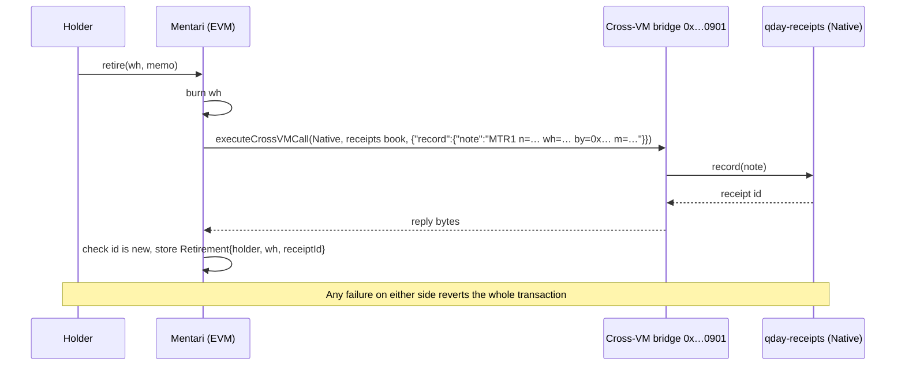

<p align="center"></p>

<h1 align="center">Mentari</h1>

<p align="center"><a href="https://github.com/aimanmalib/mentari/actions/workflows/ci.yml"></a> <a href="https://github.com/aimanmalib/mentari/blob/main/LICENSE"></a> </p>

<p align="center"><b>Solar certificates you can retire only once: burn and public receipt land together, or not at all.</b> · <i>Sijil solar yang hanya boleh dibersarakan sekali: bakar dan resit awam berlaku bersama, atau tidak langsung.</i><br>
<a href="https://mentari.sasateguh.com"><b>live demo</b></a> · <a href="#check-it-in-3-steps">check it in 3 steps</a> · <a href="#run-it">run it</a> · <a href="#limits">limits</a> · <a href="AI_USAGE.md">AI usage</a> · <a href="deck/mentari-slides.pdf">slides (PDF)</a> · <a href="README.ms.md">Bahasa Melayu</a><br>
Built in Malaysia by <a href="https://aimanmalib.com">Aiman Malib</a> · <a href="https://sasateguh.com">Sasa Teguh</a></p>

<p align="center"> </p>

An energy certificate is only worth something if it can be retired once. Most registries keep the burn in one system and
the public record in another, and the two can drift apart.

Mentari puts both in one transaction on QoreChain. Retiring a certificate burns it in an EVM contract and writes a public
receipt into a Native contract through the Cross-VM bridge, in the same transaction. If either side fails, neither
happens. Every certificate starts as a solar meter reading signed with ML-DSA-87, which the contract checks with the
`pqcVerify` precompile. Certificates only move to accounts that have a registered post-quantum key.

Built for **Build Before Q-Day: The QoreChain Developer Fest**, Cross-VM track. I built it during the fest: the first
commit is [`6012d2b`](https://github.com/aimanmalib/mentari/commit/6012d2b) on 21 November 2026.

> **Where it stands today.** The contracts, the tests, the server and the site are built. The contracts are not on the
> testnet yet, because the test accounts are not funded yet. Until they are, the live site runs on sample data and says
> so on every page, and the "Retire now" button answers with a recorded sample case. Testnet addresses, transaction hashes
> and the `verify` script come with the deployment.

## Check it in 3 steps

1. Open <https://mentari.sasateguh.com>. The registry shows the EVM ledger and the Native receipts book side by side,
   and a badge that checks the latest retirements against their receipts.
2. Go to **Try it**. "Retire now" retires 500 Wh (the amount is in [`config/limits.json`](config/limits.json)), and the three failure buttons each try a cross-VM call that must fail.
   The page shows the receipt count on both ledgers before and after. Today this runs on sample data (see above).
3. Read the proof in code. `contracts/test/` has 115 passing Foundry tests, including the four invariants below, and
   [`docs/TESTING.md`](docs/TESTING.md) shows that each invariant goes red when the contract is broken on purpose.

## How it works



- **Minting.** A registrar adds a solar system (meter, producer, capacity) with an ML-DSA-87 signature. After that, a
  daily reading signed by the meter's ML-DSA-87 key mints watt-hours to the producer. `attest` refuses a second reading
  for the same day, a reading for today or the future, and more watt-hours than the capacity allows in one day (capacity times a maximum of sun hours fixed when the
  contract is deployed).
  Signed messages include the chain id and the contract address, so a signature cannot be replayed elsewhere.
- **Moving.** `transfer` only sends to accounts whose ML-DSA-87 key is registered on chain with proof of possession
  (`pqcKeyStatus`). There is no `approve` or `transferFrom`.
- **Retiring.** `retire` burns first, builds the receipt note from typed fields, calls the bridge, reads the receipt id
  from the reply and stores it. The EVM event names the Native receipt, and the Native note names the EVM retirement, so
  anyone can match them one to one.
- **Showing atomicity.** `AtomicityProbe` is a separate, clearly labelled demo contract. It writes a receipt and then
  reverts, asks the Native contract to refuse, and calls a Native contract that governance has not approved. Each case
  must leave both ledgers unchanged.
- **Reading.** The QoreChain REST API has no CORS headers, so a small Node server serves the site and proxies a fixed
  list of read-only paths. It also sends the demo transactions from a rate-limited demo account.

More detail: [`docs/architecture.md`](docs/architecture.md). Each design decision has a record in
[`docs/decisions/`](docs/decisions/), with how to undo it.

## Cross-VM track requirements, and where they are met

| Requirement (official wording) | Where it is met | Status |
| --- | --- | --- |
| "Build an application where an EVM contract atomically calls an approved Native contract." | [`Mentari.retire`](contracts/src/Mentari.sol) calls the bridge with a `record` message for `qday-receipts`, which is on the testnet allowlist (governance proposal 40, code id 865) | In code and tests; testnet case A after deployment |
| "A working EVM-to-Native call to an approved Native contract" | Case A: one retirement that adds one receipt whose sender is the contract's `qor1…` address | Recorded in `evidence/` after deployment |
| "with atomic execution shown on testnet" | Cases B, C, D through [`AtomicityProbe`](contracts/src/AtomicityProbe.sol): the receipt count is the same before and after each | Tested against the bridge mock; testnet after deployment |
| Public repository, licence, README | This repository, [Apache-2.0](LICENSE), this file | Done |
| Testnet addresses | Receipts book `qor1xjayq5ev55tkzpml9klxwyshr7gdrha0nurha9jhm0f0gdckksgs3gltw8`; Mentari and AtomicityProbe addresses go into [`config/app.json`](config/app.json) | Contract addresses after deployment |
| "An AI_USAGE.md file documenting the workflow, the generated work and the human contribution" | [`AI_USAGE.md`](AI_USAGE.md) | Done |

## Kits and network features

The project page on the fest site is not created yet, so nothing is declared or verified there yet. This is what the code
uses today.

| Kit or feature | Version or address | Where |
| --- | --- | --- |
| `@qorechain/sdk` | 0.14.0 (pinned) | [`scripts/src/accounts.ts`](scripts/src/accounts.ts): `generateMnemonic` and `deriveUnifiedAccount` for the test accounts |
| Cross-VM bridge precompile | `0x0000000000000000000000000000000000000901` | [`contracts/src/lib/CrossVm.sol`](contracts/src/lib/CrossVm.sol) |
| `pqcVerify` precompile (ML-DSA-87) | `0x0000000000000000000000000000000000000a01` | [`contracts/src/lib/Pqc.sol`](contracts/src/lib/Pqc.sol) |
| `pqcKeyStatus` precompile | `0x0000000000000000000000000000000000000a02` | [`contracts/src/lib/Pqc.sol`](contracts/src/lib/Pqc.sol) |
| `qday-receipts` Native contract | code id 865 | the target of every retirement |
| `@qorechain/qorex-rainbowkit` | 0.1.0 (pinned) | [`web/src/wallet/setup.ts`](web/src/wallet/setup.ts): QoreX as the wallet on the Try it page |
| `@qorechain/qorex-wallet-mock` | 0.1.0 (pinned, tests only) | [`web/e2e/wallet.e2e.ts`](web/e2e/wallet.e2e.ts): QoreX in the browser tests |

## Run it

You need Node.js 22, pnpm 12.9.1 and git. The test script installs a pinned Foundry if `forge` is missing.

```sh
git clone --recurse-submodules https://github.com/aimanmalib/mentari.git
cd mentari
pnpm install --frozen-lockfile
pnpm exec playwright install chromium webkit
bash scripts/gerbang-ujian.sh   # what CI runs: forge build, test, fmt and coverage, vitest, web build, browser tests, secret scan
```

The site on your machine, on sample data:

```sh
pnpm build
pnpm start                      # http://localhost:8080
```

Only the contract tests:

```sh
cd contracts && forge test
```

## Tests

Counted on 22 November 2026 from a local run, the same steps CI runs on every push.

| Suite | Result | What it covers |
| --- | --- | --- |
| Foundry, `contracts/test/` | 115 passed, 0 failed | 98 unit tests, 16 fuzz tests (512 runs each) and one invariant suite holding 4 invariants (128 sequences of 64 calls; forge counts the suite once, so 98 + 16 + 1 = 115); line coverage of `contracts/src` 99 % |
| vitest, `server/test/` | 86 passed | the `/lcd` allowlist, client IP behind Cloudflare, demo rate limits, the off switch, fallbacks, the wallet grant |
| vitest, `web/test/` | 141 passed | the "both ledgers agree" check, the slide counts match this table, address encoding, the receipts reader, both languages have the same keys, wallet errors |
| vitest, `scripts/test/` | 38 passed | account derivation, balances, simulated meter readings and the bytes a meter signs, the health watch, the test counter |
| Playwright, `web/e2e/` | 10 passed | the wallet path with the QoreX wallet mock, 5 cases in Chromium and in WebKit as an iPhone 13 |

The four invariants hold after every random call:

1. Minted minus retired equals supply.
2. The number of retirements equals the number of receipts the bridge accepted from the contract.
3. Each retirement's receipt id is unique and increasing.
4. No balance sits on an address without a post-quantum key.

Each one was checked by breaking `Mentari.sol` on purpose; each break turns its invariant red
([`docs/TESTING.md`](docs/TESTING.md)). The fuzz tests check that no memo can put `"`, `\` or a control character into the
JSON note, and that the note never passes 140 characters.

## Threat model, in short

- **A leaked classical key.** Minting needs the meter's ML-DSA-87 signature, checked on chain. A classical key alone
  mints nothing.
- **Receivers without a post-quantum key.** An account with no registered key can be claimed by whoever breaks its
  classical key first. So `transfer` refuses such accounts.
- **JSON injection through the memo.** The memo is limited to 40 characters from `[A-Za-z0-9 .:/#-]` and the note is
  built from typed fields, so a memo cannot change the message sent to the Native contract.
- **A failed or silent bridge.** An empty or unreadable reply, or a receipt id that is not new, reverts the retirement.
- **Abuse of the demo button.** One request at a time, 5 per IP an hour, 40 a day, and an off switch, all in
  [`config/limits.json`](config/limits.json).

Full version with sources: [`docs/threat-model.md`](docs/threat-model.md).

## Limits

- **The meter is simulated.** Readings come from a seeded model of sun hours. The signatures, the contracts and the chain
  are real; the solar panels are not.
- **Testnet only.** This is a demo on the Diana testnet. It is not a recognised certificate scheme, and the certificates
  have no value.
- **Not deployed yet.** At this commit the contracts are not on the testnet, so there are no transaction hashes to show,
  and the site runs on sample data.
- **The Native side records, it does not enforce.** `qday-receipts` is the shared receipt book from the workshop. Anyone
  can write to it; Mentari's receipts are the ones whose sender is the Mentari contract.
- **The wallet path is tested with a mock only.** "Retire from your own wallet" connects QoreX, asks the demo account
  for 500 Wh and retires from the wallet. QoreX does not sign EVM transactions yet, so today it refuses that last step,
  and the page says so. The browser tests use the QoreX wallet mock: its `current` profile is refused, its `planned`
  profile sends `retire` to the contract. I have not tried it with the real extension
  ([ADR 0010](docs/decisions/0010-qorex-wallet-path.md)). "Retire now" needs no wallet.
- **No audit.** The contracts have tests, fuzzing and invariants, not a professional audit.

## AI disclosure

I built Mentari with AI coding agents (Claude Code). Almost all of the code, tests, documents and images in this
repository were generated by them, under my plan and my decisions, and checked by automated gates and a separate
reviewer agent before each commit was accepted. [`AI_USAGE.md`](AI_USAGE.md) describes the workflow, the generated work
and my contribution.

## Credits

- The QoreChain workshop examples in [qorechain/build-before-qday](https://github.com/qorechain/build-before-qday)
  (Apache-2.0): `workshop-2/01-qday-vault` for the `pqcVerify` and `pqcKeyStatus` pattern, and `workshop-3/02-cross-vm`
  for the bridge call and the receipts book. See [NOTICE](NOTICE).
- `@qorechain/sdk`, [Foundry](https://github.com/foundry-rs/foundry) and forge-std, [Vite](https://vite.dev),
  [React](https://react.dev), [wagmi](https://wagmi.sh), [RainbowKit](https://rainbowkit.com),
  [vitest](https://vitest.dev), [Playwright](https://playwright.dev), TypeScript and tsx. Versions are pinned in `package.json`,
  `pnpm-lock.yaml` and `.gitmodules`.

## Contributing

See [CONTRIBUTING.md](CONTRIBUTING.md), the [Code of Conduct](CODE_OF_CONDUCT.md) and [SECURITY.md](SECURITY.md).
Changes are listed in [CHANGELOG.md](CHANGELOG.md).

## Licence

[Apache-2.0](LICENSE). Credits for adapted patterns and third-party packages are in [NOTICE](NOTICE).

## Work with Sasa Teguh

I built this project. I run [Sasa Teguh](https://sasateguh.com), a studio in Malaysia that builds websites found on Google and in AI answers, and sets up systems like this one for businesses.

[Book a call](https://sasateguh.com/book) · hello@sasateguh.com · [More from Sasa Teguh](https://github.com/sasateguh)
