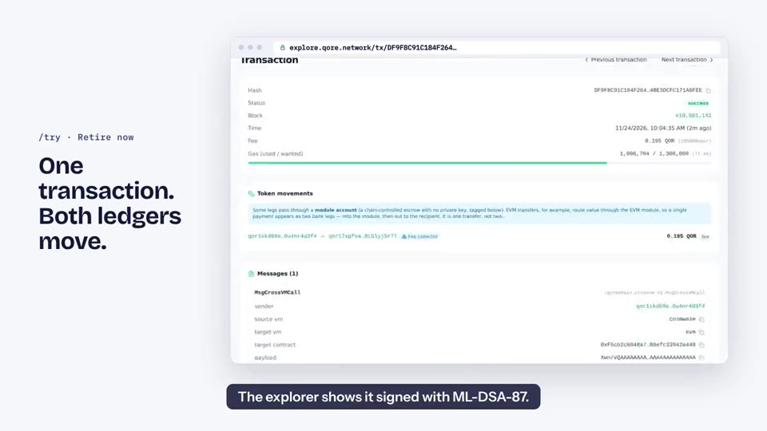
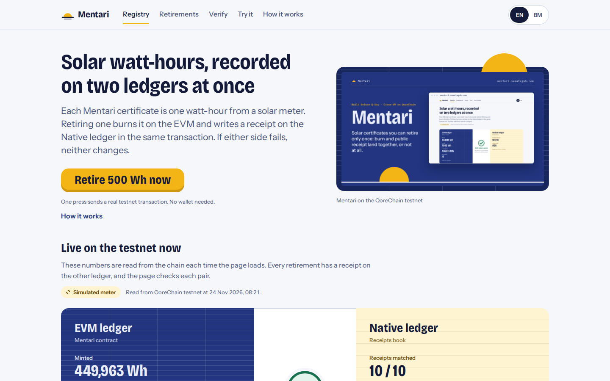
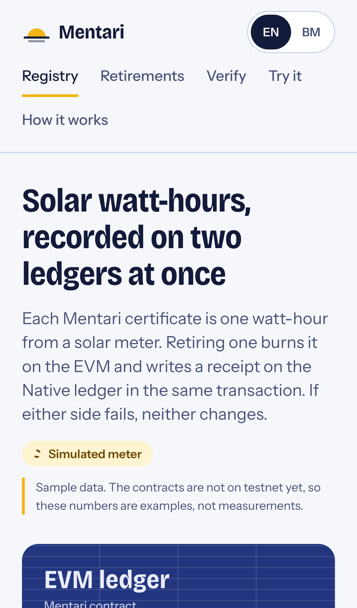
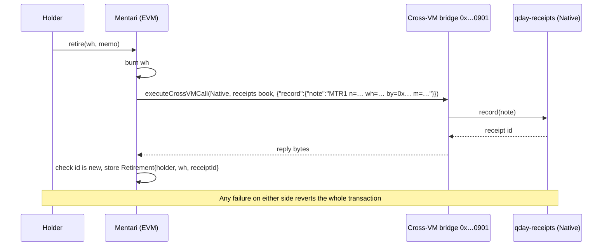
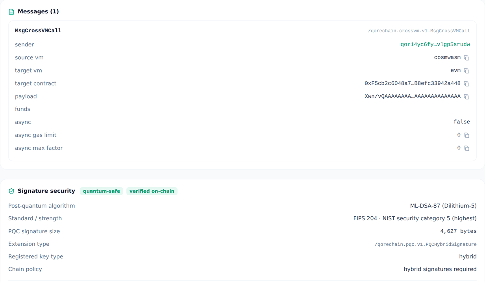

<p align="center"></p>

<h1 align="center">Mentari</h1>

<p align="center"><a href="https://github.com/aimanmalib/mentari/actions/workflows/ci.yml"></a> <a href="https://github.com/aimanmalib/mentari/blob/main/LICENSE"></a> </p>

<p align="center"><b>Solar certificates you can retire only once: burn and public receipt land together, or not at all.</b> · <i>Sijil solar yang hanya boleh dibersarakan sekali: bakar dan resit awam berlaku bersama, atau tidak langsung.</i><br>
<a href="https://mentari.sasateguh.com"><b>live demo</b></a> · <a href="https://youtu.be/ziTuy14lV1g"><b>demo video</b></a> · <a href="#judge-it-in-3-minutes">judge it in 3 minutes</a> · <a href="#proof-on-testnet">proof on testnet</a> · <a href="#the-five-judging-criteria">judging criteria</a> · <a href="#run-it">run it</a> · <a href="#limits">limits</a> · <a href="AI_USAGE.md">AI usage</a> · <a href="docs/deck.pdf">slides (PDF)</a> · <a href="README.ms.md">Bahasa Melayu</a><br>
Built in Malaysia by <a href="https://aimanmalib.com">Aiman Malib</a> · <a href="https://sasateguh.com">Sasa Teguh</a></p>

<p align="center"><a href="https://youtu.be/ziTuy14lV1g"></a><br><a href="https://youtu.be/ziTuy14lV1g"><b>Watch the demo video</b></a> on YouTube (narrated, English subtitles, under three minutes) · <a href="docs/video/mentari-demo.mp4">MP4 copy in this repo</a></p>

<p align="center"> </p>

An energy certificate is only worth something if it can be retired once. Most registries keep the burn in one system and
the public record in another, and the two can drift apart.

Mentari puts both in one transaction on QoreChain. Retiring a certificate burns it in an EVM contract and writes a public
receipt into a Native contract through the Cross-VM bridge, in the same transaction. If either side fails, neither
happens. Every certificate starts as a solar meter reading signed with ML-DSA-87, which the contract checks with the
`pqcVerify` precompile. Certificates only move to accounts that have a registered post-quantum key.

Built for **Build Before Q-Day: The QoreChain Developer Fest**, Cross-VM track. I built it during the fest: the first
commit is [`6012d2b`](https://github.com/aimanmalib/mentari/commit/6012d2b) on 21 November 2026.

> **Where it stands today** (read from [`evidence/`](evidence/)):
> - 449,963 Wh minted from meter readings, each ML-DSA-87 signature checked on chain ([`deploy.json`](evidence/deploy.json), [decision 0031](docs/decisions/0031-daily-meter-attest-gas.md)).
> - 24 retirements and 12,000 Wh retired, each matched to its Native receipt.
> - `pnpm verify` passed 107 of 107 checks ([`verify.json`](evidence/verify.json)).
> - Cases A to J2 recorded on testnet with their transactions ([`testnet.json`](evidence/testnet.json)).
> - 13 recorded presses on the public site, 7 of them "Retire now" in a row, each moving both ledgers by one ([`live.json`](evidence/live.json)).

## Judge it in 3 minutes

1. **Press.** Open <https://mentari.sasateguh.com/try> and press "Retire now". One hybrid-signed Native transaction runs
   the EVM contract, and the receipt count on both ledgers goes up by one. Then press a failure button: neither ledger
   moves. The buttons send real testnet transactions, 5 an hour for each visitor ([`config/limits.json`](config/limits.json)).
2. **Check.** Open the transaction link the page shows. The explorer starts with Mainnet selected: click Testnet once. A failure
   press shows "failed (code 14)", and each Native press shows "quantum-safe · verified on-chain · ML-DSA-87". On
   [Verify](https://mentari.sasateguh.com/verify), your browser re-checks the meters' ML-DSA-87 signatures read from the chain.
3. **Re-run.** In a fresh clone (Node 22, pnpm), run `pnpm install --frozen-lockfile && pnpm demo`. It needs no key: it
   reads the public EVM and REST endpoints, matches every retirement to its Native receipt (sender, note, amount),
   checks minted - retired = supply and each recorded case, and exits 0 only when no check fails.

## Proof on testnet

Every link opens the explorer with Mainnet selected. Click Testnet once, and the transaction shows.

| Case | What it tries | What happened | Transaction |
| --- | --- | --- | --- |
| A | Retire 500 Wh through the EVM lane | Burned, and receipts went 7 → 8 | [`5654336F…`](https://explore.qore.network/tx/5654336FDCC86E817D25DE3391FE76FFDAAC8CE92785C785E0AA276369E8A618) |
| B | Write a Native receipt, then revert on the EVM side | Reverted, receipts 8 → 8 | [`9837A24B…`](https://explore.qore.network/tx/9837A24B4D575651DB50875540C94CC58A3F1D7C6734B05F0A82846D3F260CF8) |
| C | The Native contract refuses the message | Reverted, receipts 8 → 8 | [`A6D4F275…`](https://explore.qore.network/tx/A6D4F2754F99ADE9A2BD35CA2F2668620D5799A7B7342876556E8C34F6B66CA3) |
| D | Call a Native contract that is not on the allowlist | Reverted, receipts 8 → 8 | [`55F936A6…`](https://explore.qore.network/tx/55F936A67ACE5226F2EF1BF24CA212C7C994D2D565BC92C6D047CB6CA6B0E635) |
| E | A reading signed with another account's key | `BadSignature`, receipts 25 → 25 | [`5B7A5856…`](https://explore.qore.network/tx/5B7A5856013C83DDAD15258DC6C87FFBA9B185A2EA8AB6D927A2B18ACB41900D) |
| E2 | A second reading for the same day | `AlreadyAttested`, receipts 8 → 8 | [`C4589E9A…`](https://explore.qore.network/tx/C4589E9AB637B431AD13FB2CF3E4E90F6C3F1520F4845A4709C11EE6EDFC47D3) |
| F | A reading over the system's capacity | `WhOutOfRange(40001, 40000)`, receipts 25 → 25 | [`CD9DDAE7…`](https://explore.qore.network/tx/CD9DDAE7155E6692C84E9038A8CB2D6DD196FEA3C394F79049814EFEBBFA9C34) |
| G | Transfer to an account without an ML-DSA-87 key | `NotQuantumReady`, receipts 8 → 8 | [`E405CBAB…`](https://explore.qore.network/tx/E405CBAB79FAC6335F5982E1396B65249AEC93BCF56484A0540D91B83C9A8F34) |
| H, step 1 | `attest` from the Native lane, no EVM window | Reading minted: 344,115 → 393,197 Wh | [`FC13A895…`](https://explore.qore.network/tx/FC13A89597E46C3128D351B25C351461D2EC8B30A2D053017DFC6D7175AB2A3E) |
| H, step 2 | `retire` from the Native lane, no EVM window | Burned, receipts 13 → 14 | [`8E15D319…`](https://explore.qore.network/tx/8E15D319B2971FC5102C027BA8E3C8A8AAF1FDD72AD8E2172CEE2303B453B40A) |
| I, step 1 | `retire` signed with the secp256k1 key alone, no EVM window | Refused before it reached a block: nonce 6 → 6, retirements 21 → 21 | none: the chain never took it |
| I, step 2 | The same `retire` from the Native lane | Burned, receipts 30 → 31 | [`97A5C807…`](https://explore.qore.network/tx/97A5C80786442EC1C3866D0A890FE0E21915DB22B227F675A92F9873AE4CEA38) |
| J | One Native transaction: `MsgSend` of a 0.1 QOR fee to the registrar, then `retire` | Fee paid, registrar 6.0 → 6.1 QOR; burned, receipts 32 → 33 | [`C1503B00…`](https://explore.qore.network/tx/C1503B00FEB65516D85DBC8832F32A3FD99625F807D4CEBB9A2B1BF0FB4B2527) |
| J2 | The same two messages, the `retire` asks for 1 Wh more than the buyer holds | Failed (code 14): the fee went back too, registrar 6.1 → 6.1 QOR, receipts 33 → 33 | [`3E2F2D8D…`](https://explore.qore.network/tx/3E2F2D8D3E0386F2162D0AE1EC49FBABDEFEDEE29202D480D70FC5557BF7E3AD) |
| Retire now, site | One press on the public site | Receipts 27 → 28, retirements 18 → 19 | [`922C6AF2…`](https://explore.qore.network/tx/922C6AF21D20019EB82E332396DA3EC9E696B3BFFF0B6011BA2BFE0415D3F946) |
| Write-then-revert, site | Case B as a Native transaction | Failed (code 14), receipts 28 → 28 | [`4F9B5F8D…`](https://explore.qore.network/tx/4F9B5F8D45472307558019A22A72DCF2BEB79B3599E572E8BAE6EA8D11396703) |
| Native refuses, site | Case C as a Native transaction | Failed (code 14), receipts 28 → 28 | [`7D69CA4F…`](https://explore.qore.network/tx/7D69CA4FCB6A3D21639E8A703E050D76E39E29348D7A7D151CCDD73F164FF89A) |
| Not allowlisted, site | Case D as a Native transaction | Failed (code 14), receipts 28 → 28 | [`C003B67F…`](https://explore.qore.network/tx/C003B67FFB655EB48A19965F0B7FD6E3A8C49A3C63FB2B2C85FCC0308DC4E07B) |

Cases A to G went through the EVM lane. For those, the explorer shows the transaction that carried the EVM call, and
the revert reason is in the EVM receipt, which `pnpm verify` reads. The site's buttons are Native transactions, so the
explorer shows a failed one as failed. The verbatim node error for case I is in
[`testnet.json`](evidence/testnet.json). In cases J and J2 the fee transfer runs first, so J2 shows a transfer that
ran being undone when the contract call after it reverts ([decision 0041](docs/decisions/0041-bank-transfer-and-retire-in-one-transaction.md)).

## The five judging criteria

| Criterion (official wording) | Weight | Where to check it |
| --- | --- | --- |
| Works as described | 25 % | [Try it](https://mentari.sasateguh.com/try) on the live site; [`pnpm demo`](#judge-it-in-3-minutes) and [`verify.json`](evidence/verify.json) (107 of 107); the presses in [`live.json`](evidence/live.json); the [proof table](#proof-on-testnet) |
| QoreChain tech usage, verified in the repo and on chain | 25 % | [Kits and network features](#kits-and-network-features): the bridge, `pqcVerify`, `pqcKeyStatus`, `MsgCrossVMCall`, `@qorechain/sdk`, QoreX; a bank transfer and a contract call in one transaction (case J); the qor1 addresses in the [track table](#cross-vm-track-requirements-and-where-they-are-met) |
| Post-quantum correctness and security | 20 % | [What is signed, and where](#post-quantum-what-is-signed-and-where); case I; [Verify](https://mentari.sasateguh.com/verify) re-checks ML-DSA-87 in your browser; [`docs/threat-model.md`](docs/threat-model.md) |
| Originality | 15 % | [What I found](#what-i-found-a-native-account-can-run-the-evm-contract); [`docs/findings.md`](docs/findings.md) |
| Clarity, UX and documentation | 15 % | This file and [README.ms.md](README.ms.md); the site in English and Malay; [`docs/architecture.md`](docs/architecture.md); 42 [decision records](docs/decisions/), each with how to undo it; [`AI_USAGE.md`](AI_USAGE.md) |

## What I found: a Native account can run the EVM contract

The QoreChain Cross-VM reference lists the direction "Native account to EVM contract" as "Not yet tested against the
live network: this direction was not run for this page."
([docs](https://docs.qorechain.io/developer-guide/cross-vm-reference#native-to-evm)). I ran it. One Native transaction,
signed with secp256k1 plus ML-DSA-87, called `Mentari.retire` with no EVM window open. The contract burned the
certificates and the bridge wrote the receipt on the Native ledger, in the same transaction: case H,
[`8E15D319…`](https://explore.qore.network/tx/8E15D319B2971FC5102C027BA8E3C8A8AAF1FDD72AD8E2172CEE2303B453B40A).
Every "Retire now" on the site now goes this way, for example
[`922C6AF2…`](https://explore.qore.network/tx/922C6AF21D20019EB82E332396DA3EC9E696B3BFFF0B6011BA2BFE0415D3F946).
Details and what I did not test: [`docs/findings.md`](docs/findings.md).

## How it works



- **Minting.** A registrar adds a solar system (meter, producer, capacity) with an ML-DSA-87 signature. After that, a
  daily reading signed by the meter's ML-DSA-87 key mints watt-hours to the producer. `attest` refuses a second reading
  for the same day, a reading for today or the future, and more watt-hours than the capacity allows in one day (capacity times a maximum of sun hours fixed when the
  contract is deployed).
  Signed messages include the chain id and the contract address, so a signature cannot be replayed elsewhere.
- **Moving.** `transfer` only sends to accounts whose ML-DSA-87 key is registered on chain with proof of possession
  (`pqcKeyStatus`). There is no `approve` or `transferFrom`.
- **Retiring.** `retire` burns first, builds the receipt note from typed fields, calls the bridge, reads the receipt id
  from the reply and stores it. The EVM event names the Native receipt, and the Native note names the EVM retirement, so
  anyone can match them one to one.
- **Showing atomicity.** `AtomicityProbe` is a separate, clearly labelled demo contract. It writes a receipt and then
  reverts, asks the Native contract to refuse, and calls a Native contract that governance has not approved. Each case
  must leave both ledgers unchanged.
- **Reading.** The QoreChain REST API has no CORS headers, so a small Node server serves the site and proxies a fixed
  list of read-only paths. It also sends the demo transactions from a rate-limited demo account.

More detail: [`docs/architecture.md`](docs/architecture.md). Each design decision has a record in
[`docs/decisions/`](docs/decisions/), with how to undo it.

## Cross-VM track requirements, and where they are met

| Requirement (official wording) | Where it is met | Status |
| --- | --- | --- |
| "Build an application where an EVM contract atomically calls an approved Native contract." | [`Mentari.retire`](contracts/src/Mentari.sol) calls the bridge with a `record` message for `qday-receipts`, which is on the testnet allowlist (governance proposal 40, code id 865) | Case A on testnet, block 10609362: receipts 7 → 8 ([`evidence/testnet.json`](evidence/testnet.json)) |
| "A working EVM-to-Native call to an approved Native contract" | Case A: one retirement that adds one receipt whose sender is the contract's `qor1…` address | Recorded: EVM tx `0x08e96e38…`, receipt 8 |
| "with atomic execution shown on testnet" | Cases B, C, D through [`AtomicityProbe`](contracts/src/AtomicityProbe.sol): the receipt count is the same before and after each | Recorded on testnet, blocks 10609364, 10609366, 10609368: receipts 8 → 8 each time |
| Public repository, licence, README | This repository, [Apache-2.0](LICENSE), this file | Done |
| Testnet addresses | Receipts book `qor1xjayq5ev55tkzpml9klxwyshr7gdrha0nurha9jhm0f0gdckksgs3gltw8`; Mentari `qor17h9jcczg5l8gckn6enrxaw80cvu59fzg2335fw`; AtomicityProbe `qor1wsud7p2lpktwdwsmntywwv62r0jkzv8ymglm0l` ([`config/app.json`](config/app.json)) | Done |
| "An AI_USAGE.md file documenting the workflow, the generated work and the human contribution" | [`AI_USAGE.md`](AI_USAGE.md) | Done |

## Kits and network features

This is what the code uses, and where.

| Kit or feature | Version or address | Where |
| --- | --- | --- |
| `@qorechain/sdk` | 0.14.0 (pinned) | [`scripts/src/accounts.ts`](scripts/src/accounts.ts): `generateMnemonic` and `deriveUnifiedAccount` for the test accounts; [`scripts/src/native-entry.ts`](scripts/src/native-entry.ts): `crossvm.crossVmCall` for case H |
| `MsgCrossVMCall` from an account, hybrid-signed, no EVM window | `/qorechain.crossvm.v1.MsgCrossVMCall` | case H: `Mentari.retire` called from the Native lane ([`docs/findings.md`](docs/findings.md)); every "Retire now" on the site ([`server/src/native.ts`](server/src/native.ts)) |
| Cross-VM bridge precompile | `0x0000000000000000000000000000000000000901` | [`contracts/src/lib/CrossVm.sol`](contracts/src/lib/CrossVm.sol) |
| `pqcVerify` precompile (ML-DSA-87) | `0x0000000000000000000000000000000000000a01` | [`contracts/src/lib/Pqc.sol`](contracts/src/lib/Pqc.sol) |
| `pqcKeyStatus` precompile | `0x0000000000000000000000000000000000000a02` | [`contracts/src/lib/Pqc.sol`](contracts/src/lib/Pqc.sol) |
| `qday-receipts` Native contract | code id 865 | the target of every retirement |
| `@qorechain/qorex-rainbowkit` | 0.1.0 (pinned) | [`web/src/wallet/setup.ts`](web/src/wallet/setup.ts): QoreX as the wallet on the Try it page |
| `@qorechain/qorex-types` | 0.1.0 (pinned) | [`web/src/wallet/useWalletActions.ts`](web/src/wallet/useWalletActions.ts): `qorexSignAndBroadcast`, so the wallet path retires through the Native lane |
| `@qorechain/qorex-wallet-mock` | 0.1.0 (pinned, tests and `pnpm wallet-run`) | [`web/e2e/wallet.e2e.ts`](web/e2e/wallet.e2e.ts): QoreX in the browser tests; [`scripts/wallet-run.ts`](scripts/wallet-run.ts): the same path on the testnet |

## Run it

You need Node.js 22, pnpm 12.9.1 and git. The test script installs a pinned Foundry if `forge` is missing.

```sh
git clone --recurse-submodules https://github.com/aimanmalib/mentari.git
cd mentari
pnpm install --frozen-lockfile
pnpm exec playwright install chromium webkit
bash scripts/gerbang-ujian.sh   # what CI runs: forge build, test, fmt and coverage, vitest, web build, browser tests, secret scan
```

The site on your machine. It reads the testnet; building with `VITE_MENTARI_DATA=sample` uses the local fixture instead:

```sh
pnpm build
pnpm start                      # http://localhost:8080
```

Only the contract tests:

```sh
cd contracts && forge test
```

## Tests

Counted on 24 November 2026: Foundry and server from the CI run on commit `1577e46` (the Foundry suite was last changed on 22 November), web, scripts and Playwright from local runs of the commit that added the Native wallet path. CI runs the same steps on every push; `bash scripts/gerbang-ujian.sh` runs them locally.

| Suite | Result | What it covers |
| --- | --- | --- |
| Foundry, `contracts/test/` | 115 passed, 0 failed | 98 unit tests, 16 fuzz tests (512 runs each) and one invariant suite holding 4 invariants (128 sequences of 64 calls; forge counts the suite once, so 98 + 16 + 1 = 115); line coverage of `contracts/src` 99 % |
| vitest, `server/test/` | 223 passed | the `/lcd` allowlist, client IP behind Cloudflare, demo rate limits, the off switch, fallbacks, the wallet grant, the live demo sender on a local node, the hybrid-signed Native route for "Retire now", the daily meter run and its chain job, the `/go/tx` and `/go/receipt` explorer redirects, the failure buttons sent on the Native lane and the honest demo status |
| vitest, `web/test/` | 249 passed | the "both ledgers agree" check, the ML-DSA-87 re-check in the browser against real testnet signatures and a one-byte change, the home page story, the Native-lane finding, the link preview tags, preview and cover image sizes, the slide counts match this table, each of the five judging criteria heads a slide, the session counts in AI_USAGE.md add up and match the slides, its test counts match this table, the slide PDF is the one printed from the slide source, address encoding, the receipts reader, both languages have the same keys, wallet errors, the event search split into ranges the public node accepts, the stale phrases guard, the README numbers and links |
| vitest, `scripts/test/` | 175 passed | account derivation, the wallet messages the site encodes against the SDK, balances, funding, key registration and EVM windows on the Native lane, the Native-entry experiment (case H), simulated meter readings and the bytes a meter signs, deploy, registration and attestation on a local node, the one-command testnet setup, the health watch, the low-funds watch, the account evidence file, the live Try it record, the test counter, the classic-key refusal (case I), the bank transfer and retire in one transaction (cases J and J2), the live self-test, the deploy freeze |
| Playwright, `web/e2e/` | 16 passed | the home page and its Retire now action, and the wallet path with the QoreX wallet mock (Native lane retire, key registration, no funds, EVM fallback, a declined request, Malay): 8 cases in Chromium and in WebKit as an iPhone 13 |

The four invariants hold after every random call:

1. Minted minus retired equals supply.
2. The number of retirements equals the number of receipts the bridge accepted from the contract.
3. Each retirement's receipt id is unique and increasing.
4. No balance sits on an address without a post-quantum key.

Each one was checked by breaking `Mentari.sol` on purpose; each break turns its invariant red
([`docs/TESTING.md`](docs/TESTING.md)). The fuzz tests check that no memo can put `"`, `\` or a control character into the
JSON note, and that the note never passes 140 characters.

## Post-quantum: what is signed, and where

| Action | Post-quantum signature | Checked by |
| --- | --- | --- |
| Register a system, mint a daily reading | Registrar's or meter's ML-DSA-87 signature | `Mentari` itself, with `pqcVerify` |
| Retire now, the failure buttons, `grant`, the daily meter call | Hybrid (secp256k1 + ML-DSA-87), sent from the Native lane with no EVM window | The chain |
| Any EVM transaction signed with secp256k1 alone | None | The chain refuses it unless the account has an open, scoped EVM window |

`retire` and `transfer` act for `msg.sender`; they take no post-quantum signature of their own. So the contract comment
"not from `msg.sender`" is true for minting and registration, not for those two. The chain closes the gap: in case I,
a `retire` signed with the buyer's classical key alone was refused ("has no open EVM authorisation window"), nonce 6
before and after. The same `retire` from the Native lane then went through
([`97A5C807…CEA38`](https://explore.qore.network/tx/97A5C80786442EC1C3866D0A890FE0E21915DB22B227F675A92F9873AE4CEA38)).
The explorer, switched to Testnet, labels it like this:

<p align="center"></p>

The early EVM lane transactions (cases A to D, the deploys) show "not quantum-safe". Details and the untested case (a
classical key inside an open window): [`docs/threat-model.md`](docs/threat-model.md#who-may-call-retire-and-transfer-t12).

## Threat model, in short

- **A leaked classical key.** Minting needs the meter's ML-DSA-87 signature, checked on chain. A classical key alone
  mints nothing, and the chain refuses its EVM transactions while the account has no open window (case I).
- **Receivers without a post-quantum key.** An account with no registered key can be claimed by whoever breaks its
  classical key first. So `transfer` refuses such accounts.
- **JSON injection through the memo.** The memo is limited to 40 characters from `[A-Za-z0-9 .:/#-]` and the note is
  built from typed fields, so a memo cannot change the message sent to the Native contract.
- **A failed or silent bridge.** An empty or unreadable reply, or a receipt id that is not new, reverts the retirement.
- **Abuse of the demo button.** One request at a time, 5 per IP an hour, 40 a day, and an off switch, all in
  [`config/limits.json`](config/limits.json).

Full version with sources: [`docs/threat-model.md`](docs/threat-model.md).

## Limits

- **The meter is simulated.** Readings come from a seeded model of sun hours. The signatures, the contracts and the chain
  are real; the solar panels are not.
- **Testnet only.** This is a demo on the Diana testnet. It is not a recognised certificate scheme, and the certificates
  have no value.
- **The Native side records, it does not enforce.** `qday-receipts` is the shared receipt book from the workshop. Anyone
  can write to it; Mentari's receipts are the ones whose sender is the Mentari contract.
- **The wallet path ran on the testnet with the wallet mock, not the real extension.** "Retire from your own wallet"
  hands QoreX one `MsgCrossVMCall` into `Mentari.retire`; QoreX signs it with the hybrid ML-DSA-87 signature and sends
  it on the Native lane. `pnpm wallet-run` did that on 24 November 2026 with the QoreX wallet mock's `current` profile
  (retirement 25, [`evidence/wallet-native.json`](evidence/wallet-native.json)). I have not run it with the QoreX
  extension. QoreX keeps separate Native and EVM accounts, and this path uses the Native one
  ([ADR 0042](docs/decisions/0042-wallet-retires-through-the-native-lane.md)). "Retire now" needs no wallet.
- **No audit.** The contracts have tests, fuzzing and invariants, not a professional audit.

## AI disclosure

I built Mentari with AI coding agents (Claude Code). Almost all of the code, tests, documents and images in this
repository were generated by them, under my plan and my decisions, and checked by automated gates and a separate
reviewer agent before each commit was accepted. [`AI_USAGE.md`](AI_USAGE.md) describes the workflow, the generated work
and my contribution.

## Credits

- The QoreChain workshop examples in [qorechain/build-before-qday](https://github.com/qorechain/build-before-qday)
  (Apache-2.0): `workshop-2/01-qday-vault` for the `pqcVerify` and `pqcKeyStatus` pattern, and `workshop-3/02-cross-vm`
  for the bridge call and the receipts book. See [NOTICE](NOTICE).
- `@qorechain/sdk`, [Foundry](https://github.com/foundry-rs/foundry) and forge-std, [Vite](https://vite.dev),
  [React](https://react.dev), [wagmi](https://wagmi.sh), [RainbowKit](https://rainbowkit.com),
  [vitest](https://vitest.dev), [Playwright](https://playwright.dev), TypeScript and tsx. Versions are pinned in `package.json`,
  `pnpm-lock.yaml` and `.gitmodules`.
- Fonts: [Bricolage Grotesque](https://github.com/ateliertriay/bricolage), [Instrument Sans](https://github.com/Instrument/instrument-sans)
  and [IBM Plex Mono](https://github.com/IBM/plex), all under the SIL Open Font License 1.1, served from Fontsource
  packages on the site and from `deck/fonts/` (licence files included) in the slides.
- The music in the demo video is by Sascha Ende, [ende.app](https://ende.app) (CC BY 4.0). The narration is an AI clone
  of my own voice ([decision 0032](docs/decisions/0032-demo-video.md)).

## Contributing

See [CONTRIBUTING.md](CONTRIBUTING.md), the [Code of Conduct](CODE_OF_CONDUCT.md) and [SECURITY.md](SECURITY.md).
Changes are listed in [CHANGELOG.md](CHANGELOG.md).

## Licence

[Apache-2.0](LICENSE). Credits for adapted patterns and third-party packages are in [NOTICE](NOTICE).

## Work with Sasa Teguh

I built this project. I run [Sasa Teguh](https://sasateguh.com), a studio in Malaysia that builds websites found on Google and in AI answers, and sets up systems like this one for businesses.

[Book a call](https://sasateguh.com/book) · hello@sasateguh.com · [More from Sasa Teguh](https://github.com/sasateguh)
