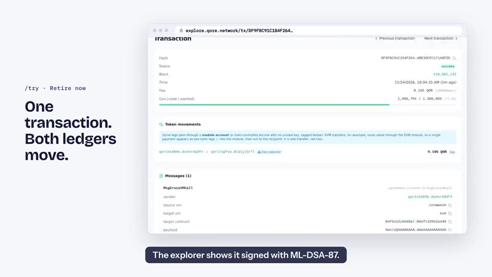
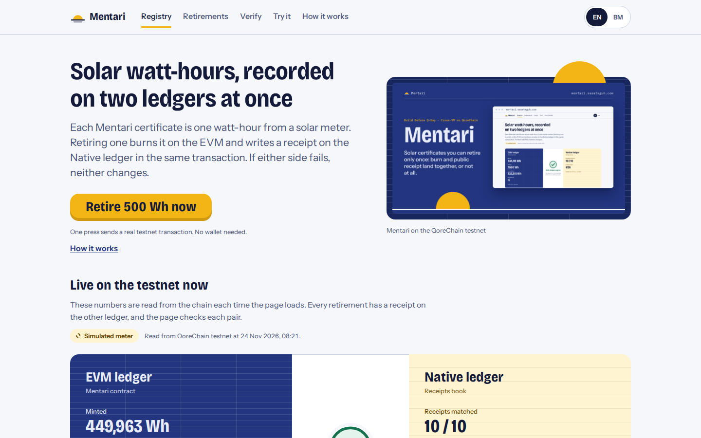
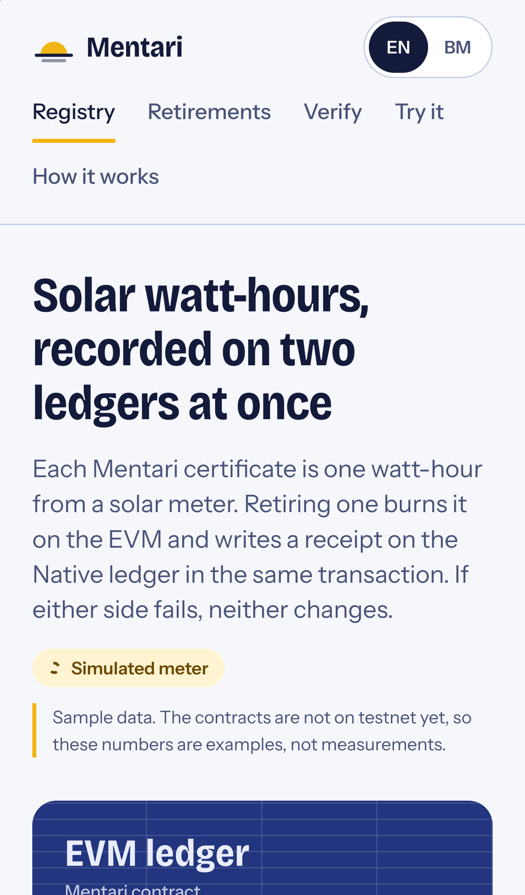
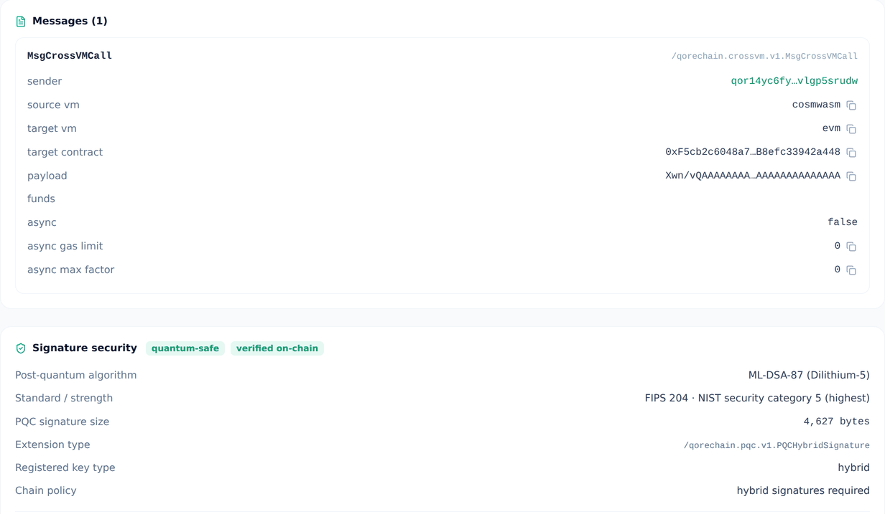

<p align="center"></p>

<h1 align="center">Mentari</h1>

<p align="center"><a href="https://github.com/aimanmalib/mentari/actions/workflows/ci.yml"></a> <a href="https://github.com/aimanmalib/mentari/blob/main/LICENSE"></a> </p>

<p align="center"><b>Sijil solar yang hanya boleh dibersarakan sekali: bakar dan resit awam berlaku bersama, atau tidak langsung.</b> · <i>Solar certificates you can retire only once: burn and public receipt land together, or not at all.</i><br>
<a href="https://mentari.sasateguh.com"><b>demo langsung</b></a> · <a href="docs/video/mentari-demo.mp4"><b>video demo</b></a> · <a href="#nilai-dalam-3-minit">nilai dalam 3 minit</a> · <a href="#bukti-di-testnet">bukti di testnet</a> · <a href="#lima-kriteria-penjurian">kriteria penjurian</a> · <a href="#jalankan">jalankan</a> · <a href="#had">had</a> · <a href="AI_USAGE.md">penggunaan AI</a> · <a href="docs/deck.pdf">slaid (PDF)</a> · <a href="README.md">English</a><br>
Dibina di Malaysia oleh <a href="https://aimanmalib.com">Aiman Malib</a> · <a href="https://sasateguh.com">Sasa Teguh</a></p>

<p align="center"><a href="docs/video/mentari-demo.mp4"></a><br><a href="docs/video/mentari-demo.mp4"><b>Tonton video demo</b></a> (bersuara, sari kata Inggeris, kurang tiga minit)</p>

<p align="center"> </p>

Sijil tenaga hanya bernilai jika ia boleh dibersarakan sekali. Kebanyakan daftar menyimpan pembakaran dalam satu sistem
dan rekod awam dalam sistem lain, dan kedua-duanya boleh tersasar.

Mentari meletakkan kedua-duanya dalam satu transaksi di QoreChain. Membersarakan sijil membakarnya dalam kontrak EVM dan
menulis resit awam ke dalam kontrak Native melalui jambatan Cross-VM, dalam transaksi yang sama. Jika mana-mana pihak
gagal, kedua-duanya tidak berlaku. Setiap sijil bermula sebagai bacaan meter solar yang ditandatangani dengan ML-DSA-87,
yang kontrak semak dengan precompile `pqcVerify`. Sijil hanya boleh berpindah ke akaun yang sudah mendaftar kunci
pasca-kuantum.

Dibina untuk **Build Before Q-Day: The QoreChain Developer Fest**, trek Cross-VM. Saya membinanya semasa fest: komit
pertama ialah [`6012d2b`](https://github.com/aimanmalib/mentari/commit/6012d2b) pada 21 November 2026.

> **Keadaan hari ini** (dibaca dari [`evidence/`](evidence/)):
> - 449,963 Wh dicetak daripada bacaan meter, setiap tandatangan ML-DSA-87 disemak di rantai ([`deploy.json`](evidence/deploy.json), [keputusan 0031](docs/decisions/0031-daily-meter-attest-gas.md), dalam bahasa Inggeris).
> - 24 persaraan dan 12,000 Wh dibersarakan, setiap satu sepadan dengan resit Native-nya.
> - `pnpm verify` lulus 107 daripada 107 semakan ([`verify.json`](evidence/verify.json)).
> - Kes A hingga J2 direkod di testnet bersama transaksinya ([`testnet.json`](evidence/testnet.json)).
> - 13 tekanan direkod di laman awam, 7 daripadanya "Retire now" berturut-turut, setiap satu menaikkan kedua-dua lejar satu ([`live.json`](evidence/live.json)).

## Nilai dalam 3 minit

1. **Tekan.** Buka <https://mentari.sasateguh.com/try> dan tekan "Retire now". Satu transaksi Native bertandatangan
   hibrid menjalankan kontrak EVM, dan kiraan resit di kedua-dua lejar naik satu. Kemudian tekan butang kegagalan:
   kedua-dua lejar tidak berubah. Butang ini menghantar transaksi testnet sebenar, 5 sejam bagi setiap pelawat
   ([`config/limits.json`](config/limits.json)).
2. **Semak.** Buka pautan transaksi yang halaman tunjukkan. Penjelajah dibuka pada Mainnet: klik Testnet sekali.
   Tekanan kegagalan menunjukkan "failed (code 14)", dan setiap tekanan Native menunjukkan "quantum-safe · verified
   on-chain · ML-DSA-87". Di [Verify](https://mentari.sasateguh.com/verify), pelayar anda menyemak semula tandatangan
   ML-DSA-87 meter yang dibaca dari rantai.
3. **Jalankan semula.** Dalam klon baharu (Node 22, pnpm), jalankan `pnpm install --frozen-lockfile && pnpm demo`. Ia
   tidak perlukan kunci: ia membaca titik hujung EVM dan REST awam, memadankan setiap persaraan dengan resit Native-nya
   (pengirim, nota, jumlah), menyemak dicetak - dibersara = bekalan dan setiap kes yang direkod, dan keluar 0 hanya bila
   tiada semakan gagal.

## Bukti di testnet

Setiap pautan membuka penjelajah pada Mainnet. Klik Testnet sekali, dan transaksi itu dipaparkan.

| Kes | Apa yang dicuba | Apa berlaku | Transaksi |
| --- | --- | --- | --- |
| A | Bersarakan 500 Wh melalui lorong EVM | Dibakar, resit 7 → 8 | [`5654336F…`](https://explore.qore.network/tx/5654336FDCC86E817D25DE3391FE76FFDAAC8CE92785C785E0AA276369E8A618) |
| B | Tulis resit Native, kemudian berbalik di sisi EVM | Berbalik, resit 8 → 8 | [`9837A24B…`](https://explore.qore.network/tx/9837A24B4D575651DB50875540C94CC58A3F1D7C6734B05F0A82846D3F260CF8) |
| C | Kontrak Native menolak mesej | Berbalik, resit 8 → 8 | [`A6D4F275…`](https://explore.qore.network/tx/A6D4F2754F99ADE9A2BD35CA2F2668620D5799A7B7342876556E8C34F6B66CA3) |
| D | Panggil kontrak Native yang tiada dalam senarai dibenarkan | Berbalik, resit 8 → 8 | [`55F936A6…`](https://explore.qore.network/tx/55F936A67ACE5226F2EF1BF24CA212C7C994D2D565BC92C6D047CB6CA6B0E635) |
| E | Bacaan ditandatangani dengan kunci akaun lain | `BadSignature`, resit 25 → 25 | [`5B7A5856…`](https://explore.qore.network/tx/5B7A5856013C83DDAD15258DC6C87FFBA9B185A2EA8AB6D927A2B18ACB41900D) |
| E2 | Bacaan kedua untuk hari yang sama | `AlreadyAttested`, resit 8 → 8 | [`C4589E9A…`](https://explore.qore.network/tx/C4589E9AB637B431AD13FB2CF3E4E90F6C3F1520F4845A4709C11EE6EDFC47D3) |
| F | Bacaan melebihi kapasiti sistem | `WhOutOfRange(40001, 40000)`, resit 25 → 25 | [`CD9DDAE7…`](https://explore.qore.network/tx/CD9DDAE7155E6692C84E9038A8CB2D6DD196FEA3C394F79049814EFEBBFA9C34) |
| G | Pindah ke akaun tanpa kunci ML-DSA-87 | `NotQuantumReady`, resit 8 → 8 | [`E405CBAB…`](https://explore.qore.network/tx/E405CBAB79FAC6335F5982E1396B65249AEC93BCF56484A0540D91B83C9A8F34) |
| H, langkah 1 | `attest` dari lorong Native, tanpa EVM window | Bacaan dicetak: 344,115 → 393,197 Wh | [`FC13A895…`](https://explore.qore.network/tx/FC13A89597E46C3128D351B25C351461D2EC8B30A2D053017DFC6D7175AB2A3E) |
| H, langkah 2 | `retire` dari lorong Native, tanpa EVM window | Dibakar, resit 13 → 14 | [`8E15D319…`](https://explore.qore.network/tx/8E15D319B2971FC5102C027BA8E3C8A8AAF1FDD72AD8E2172CEE2303B453B40A) |
| I, langkah 1 | `retire` ditandatangani dengan kunci secp256k1 sahaja, tanpa EVM window | Ditolak sebelum sampai ke blok: nonce 6 → 6, persaraan 21 → 21 | tiada: rantai tidak menerimanya |
| I, langkah 2 | `retire` yang sama dari lorong Native | Dibakar, resit 30 → 31 | [`97A5C807…`](https://explore.qore.network/tx/97A5C80786442EC1C3866D0A890FE0E21915DB22B227F675A92F9873AE4CEA38) |
| J | Satu transaksi Native: `MsgSend` yuran 0.1 QOR kepada pendaftar, kemudian `retire` | Yuran dibayar, pendaftar 6.0 → 6.1 QOR; dibakar, resit 32 → 33 | [`C1503B00…`](https://explore.qore.network/tx/C1503B00FEB65516D85DBC8832F32A3FD99625F807D4CEBB9A2B1BF0FB4B2527) |
| J2 | Dua mesej yang sama, `retire` meminta 1 Wh lebih daripada pegangan pembeli | Gagal (kod 14): yuran turut kembali, pendaftar 6.1 → 6.1 QOR, resit 33 → 33 | [`3E2F2D8D…`](https://explore.qore.network/tx/3E2F2D8D3E0386F2162D0AE1EC49FBABDEFEDEE29202D480D70FC5557BF7E3AD) |
| Retire now, laman | Satu tekanan di laman awam | Resit 27 → 28, persaraan 18 → 19 | [`922C6AF2…`](https://explore.qore.network/tx/922C6AF21D20019EB82E332396DA3EC9E696B3BFFF0B6011BA2BFE0415D3F946) |
| Write-then-revert, laman | Kes B sebagai transaksi Native | Gagal (kod 14), resit 28 → 28 | [`4F9B5F8D…`](https://explore.qore.network/tx/4F9B5F8D45472307558019A22A72DCF2BEB79B3599E572E8BAE6EA8D11396703) |
| Native refuses, laman | Kes C sebagai transaksi Native | Gagal (kod 14), resit 28 → 28 | [`7D69CA4F…`](https://explore.qore.network/tx/7D69CA4FCB6A3D21639E8A703E050D76E39E29348D7A7D151CCDD73F164FF89A) |
| Not allowlisted, laman | Kes D sebagai transaksi Native | Gagal (kod 14), resit 28 → 28 | [`C003B67F…`](https://explore.qore.network/tx/C003B67FFB655EB48A19965F0B7FD6E3A8C49A3C63FB2B2C85FCC0308DC4E07B) |

Kes A hingga G melalui lorong EVM. Untuk kes itu, penjelajah menunjukkan transaksi yang membawa panggilan EVM, dan
sebab berbalik ada dalam resit EVM, yang `pnpm verify` baca. Butang di laman ialah transaksi Native, jadi penjelajah
menunjukkan yang gagal sebagai gagal. Ralat nod asal untuk kes I ada dalam [`testnet.json`](evidence/testnet.json).
Dalam kes J dan J2 pindahan yuran berjalan dahulu, jadi J2 menunjukkan pindahan yang sudah berjalan dibatalkan apabila
panggilan kontrak selepasnya berbalik ([keputusan 0041](docs/decisions/0041-bank-transfer-and-retire-in-one-transaction.md)).

## Lima kriteria penjurian

| Kriteria (kata rasmi) | Berat | Di mana menyemaknya |
| --- | --- | --- |
| Works as described | 25 % | [Try it](https://mentari.sasateguh.com/try) di laman hidup; [`pnpm demo`](#nilai-dalam-3-minit) dan [`verify.json`](evidence/verify.json) (107 daripada 107); tekanan dalam [`live.json`](evidence/live.json); [jadual bukti](#bukti-di-testnet) |
| QoreChain tech usage, verified in the repo and on chain | 25 % | [Kit dan ciri rangkaian](README.md#kits-and-network-features) (dalam bahasa Inggeris): jambatan, `pqcVerify`, `pqcKeyStatus`, `MsgCrossVMCall`, `@qorechain/sdk`, QoreX; pindahan bank dan panggilan kontrak dalam satu transaksi (kes J); alamat qor1 dalam [jadual trek](#keperluan-trek-cross-vm-dan-di-mana-ia-dipenuhi) |
| Post-quantum correctness and security | 20 % | [Apa ditandatangani, dan di mana](#pasca-kuantum-apa-ditandatangani-dan-di-mana); kes I; [Verify](https://mentari.sasateguh.com/verify) menyemak semula ML-DSA-87 dalam pelayar anda; [`docs/threat-model.md`](docs/threat-model.md) |
| Originality | 15 % | [Apa yang saya temui](#apa-yang-saya-temui-akaun-native-boleh-menjalankan-kontrak-evm); [`docs/findings.md`](docs/findings.md) |
| Clarity, UX and documentation | 15 % | Fail ini dan [README.md](README.md); laman dalam bahasa Inggeris dan Melayu; [`docs/architecture.md`](docs/architecture.md); 42 [rekod keputusan](docs/decisions/), setiap satu dengan cara mengundurnya; [`AI_USAGE.md`](AI_USAGE.md) |

## Apa yang saya temui: akaun Native boleh menjalankan kontrak EVM

Rujukan Cross-VM QoreChain menyenaraikan arah "Native account to EVM contract" sebagai "Not yet tested against the live
network: this direction was not run for this page."
([dokumen](https://docs.qorechain.io/developer-guide/cross-vm-reference#native-to-evm)). Saya menjalankannya. Satu
transaksi Native, ditandatangani dengan secp256k1 dan ML-DSA-87, memanggil `Mentari.retire` tanpa EVM window terbuka.
Kontrak membakar sijil dan jambatan menulis resit di lejar Native, dalam transaksi yang sama: kes H,
[`8E15D319…`](https://explore.qore.network/tx/8E15D319B2971FC5102C027BA8E3C8A8AAF1FDD72AD8E2172CEE2303B453B40A).
Setiap "Retire now" di laman kini melalui jalan ini, contohnya
[`922C6AF2…`](https://explore.qore.network/tx/922C6AF21D20019EB82E332396DA3EC9E696B3BFFF0B6011BA2BFE0415D3F946).
Butiran dan apa yang tidak saya uji: [`docs/findings.md`](docs/findings.md) (dalam bahasa Inggeris).

## Cara ia berfungsi

- **Mencetak.** Pendaftar menambah sistem solar (meter, pengeluar, kapasiti) dengan tandatangan ML-DSA-87. Selepas itu,
  bacaan harian yang ditandatangani kunci ML-DSA-87 meter mencetak watt-jam kepada pengeluar. Bacaan kedua untuk hari
  yang sama, bacaan untuk hari ini atau masa depan, dan watt-jam melebihi had kapasiti sehari semuanya ditolak.
- **Memindah.** `transfer` hanya menghantar ke akaun yang kunci ML-DSA-87nya berdaftar di rantai dengan bukti pemilikan.
  Tiada `approve` atau `transferFrom`.
- **Membersarakan.** `retire` membakar dahulu, membina nota resit daripada medan bertaip, memanggil jambatan `0x…0901`,
  membaca id resit daripada jawapan dan menyimpannya. Peristiwa EVM menamakan resit Native, dan nota Native menamakan
  persaraan EVM, jadi sesiapa boleh memadankannya satu dengan satu.
- **Menunjukkan atomik.** `AtomicityProbe` ialah kontrak demo berasingan yang berlabel jelas. Ia menulis resit lalu
  berbalik, meminta kontrak Native menolak, dan memanggil kontrak Native yang tidak diluluskan tadbir urus. Setiap kes
  mesti meninggalkan kedua-dua lejar tanpa perubahan.
- **Membaca.** API REST QoreChain tiada pengepala CORS, jadi pelayan Node kecil menghidang laman dan memproksi senarai
  laluan baca-sahaja yang tetap. Ia juga menghantar transaksi demo daripada akaun demo yang berhad kadar.

Butiran lanjut (dalam bahasa Inggeris): [`docs/architecture.md`](docs/architecture.md), [`docs/threat-model.md`](docs/threat-model.md)
dan rekod keputusan dalam [`docs/decisions/`](docs/decisions/).

## Keperluan trek Cross-VM, dan di mana ia dipenuhi

| Keperluan (teks rasmi) | Di mana ia dipenuhi | Status |
| --- | --- | --- |
| "Build an application where an EVM contract atomically calls an approved Native contract." | [`Mentari.retire`](contracts/src/Mentari.sol) memanggil jambatan dengan mesej `record` untuk `qday-receipts`, yang ada dalam senarai dibenarkan testnet (cadangan tadbir urus 40, id kod 865) | Kes A di testnet, blok 10609362: resit 7 → 8 ([`evidence/testnet.json`](evidence/testnet.json)) |
| "A working EVM-to-Native call to an approved Native contract" | Kes A: satu persaraan yang menambah satu resit dengan pengirim alamat `qor1…` kontrak | Direkod: tx EVM `0x08e96e38…`, resit 8 |
| "with atomic execution shown on testnet" | Kes B, C, D melalui [`AtomicityProbe`](contracts/src/AtomicityProbe.sol): kiraan resit sama sebelum dan selepas setiap kes | Direkod di testnet, blok 10609364, 10609366, 10609368: resit 8 → 8 setiap kali |
| Repo awam, lesen, README | Repo ini, [Apache-2.0](LICENSE), fail ini | Siap |
| Alamat testnet | Buku resit `qor1xjayq5ev55tkzpml9klxwyshr7gdrha0nurha9jhm0f0gdckksgs3gltw8`; Mentari `qor17h9jcczg5l8gckn6enrxaw80cvu59fzg2335fw`; AtomicityProbe `qor1wsud7p2lpktwdwsmntywwv62r0jkzv8ymglm0l` ([`config/app.json`](config/app.json)) | Siap |
| "An AI_USAGE.md file documenting the workflow, the generated work and the human contribution" | [`AI_USAGE.md`](AI_USAGE.md) | Siap |

## Jalankan

Perlu Node.js 22, pnpm 12.9.1 dan git. Skrip ujian memasang Foundry yang dipin jika `forge` tiada.

```sh
git clone --recurse-submodules https://github.com/aimanmalib/mentari.git
cd mentari
pnpm install --frozen-lockfile
pnpm exec playwright install chromium webkit
bash scripts/gerbang-ujian.sh   # sama seperti CI
pnpm build && pnpm start        # laman di http://localhost:8080, membaca testnet
```

## Ujian

Dikira pada 24 November 2026: Foundry dan server daripada larian CI pada komit `1577e46` (suite Foundry kali terakhir berubah pada 22 November), web, scripts dan Playwright daripada larian tempatan komit yang menambah laluan dompet Native. CI menjalankan langkah yang sama pada setiap tolakan; `bash scripts/gerbang-ujian.sh` menjalankannya secara tempatan.

| Suite | Hasil |
| --- | --- |
| Foundry, `contracts/test/` | 115 lulus: 98 ujian unit, 16 ujian fuzz (512 larian setiap satu) dan satu suite invarian yang memegang 4 invarian (forge mengira suite itu sekali, jadi 98 + 16 + 1 = 115); liputan baris `contracts/src` 99 % |
| vitest, `server/test/` | 223 lulus |
| vitest, `web/test/` | 249 lulus |
| vitest, `scripts/test/` | 175 lulus |
| Playwright, `web/e2e/` | 16 lulus: halaman utama dan tindakan Retire now, serta laluan dompet dengan dompet tiruan QoreX (persaraan lorong Native, pendaftaran kunci, tiada dana, sandaran EVM, permintaan ditolak, bahasa Melayu), 8 kes dalam Chromium dan WebKit sebagai iPhone 13 |

Empat invarian: dicetak tolak dibersara sama dengan bekalan; bilangan persaraan sama dengan bilangan resit yang jambatan
terima daripada kontrak; id resit setiap persaraan unik dan menaik; tiada baki pada alamat tanpa kunci pasca-kuantum.

## Pasca-kuantum: apa ditandatangani, dan di mana

| Tindakan | Tandatangan pasca-kuantum | Disemak oleh |
| --- | --- | --- |
| Daftar sistem, cetak bacaan harian | Tandatangan ML-DSA-87 pendaftar atau meter | `Mentari` sendiri, dengan `pqcVerify` |
| Retire now, butang gagal, `grant`, panggilan meter harian | Hibrid (secp256k1 + ML-DSA-87), dihantar dari lorong Native tanpa tetingkap EVM | Rantai |
| Mana-mana transaksi EVM bertandatangan secp256k1 sahaja | Tiada | Rantai menolaknya kecuali akaun ada tetingkap EVM berskop yang terbuka |

`retire` dan `transfer` bertindak untuk `msg.sender`; kedua-duanya tidak mengambil tandatangan pasca-kuantum sendiri.
Jadi komen kontrak "not from `msg.sender`" benar untuk pencetakan dan pendaftaran, bukan untuk dua fungsi itu. Rantai
menutup jurang itu: dalam kes I, `retire` bertandatangan kunci klasik pembeli sahaja ditolak ("has no open EVM
authorisation window"), nonce 6 sebelum dan selepas. `retire` yang sama dari lorong Native kemudian diterima
([`97A5C807…CEA38`](https://explore.qore.network/tx/97A5C80786442EC1C3866D0A890FE0E21915DB22B227F675A92F9873AE4CEA38)).
Penjelajah, selepas ditukar ke Testnet, melabelnya begini:

<p align="center"></p>

Transaksi lorong EVM yang awal (kes A hingga D, deploy) dilabel "not quantum-safe". Butiran dan kes yang belum diuji
(kunci klasik dalam tetingkap yang terbuka, dalam bahasa Inggeris):
[`docs/threat-model.md`](docs/threat-model.md#who-may-call-retire-and-transfer-t12).

## Model ancaman, ringkas

- **Kunci klasik yang bocor.** Cetakan perlu tandatangan ML-DSA-87 meter, disemak dalam rantai. Kunci klasik sahaja
  tidak mencetak apa-apa, dan rantai menolak transaksi EVMnya selagi akaun tiada tetingkap terbuka (kes I).
- **Penerima tanpa kunci pasca-kuantum.** Akaun tanpa kunci berdaftar boleh dituntut oleh sesiapa yang memecahkan kunci
  klasiknya dahulu. Jadi `transfer` menolak akaun begitu.
- **Suntikan JSON melalui memo.** Memo dihadkan kepada 40 aksara daripada `[A-Za-z0-9 .:/#-]` dan nota dibina daripada
  medan bertaip, jadi memo tidak boleh mengubah mesej yang dihantar kepada kontrak Native.
- **Jambatan yang gagal atau senyap.** Balasan kosong atau tidak boleh dibaca, atau id resit yang tidak baharu,
  membalikkan persaraan.
- **Penyalahgunaan butang demo.** Satu permintaan pada satu masa, 5 setiap IP sejam, 40 sehari, dan suis henti, semuanya
  dalam [`config/limits.json`](config/limits.json).

Versi penuh dengan sumber (dalam bahasa Inggeris): [`docs/threat-model.md`](docs/threat-model.md).

## Had

- **Meter disimulasi.** Bacaan datang daripada model jam matahari berbenih. Tandatangan, kontrak dan rantai adalah
  sebenar; panel solarnya tidak.
- **Testnet sahaja.** Ini demo di testnet Diana, bukan skim sijil yang diiktiraf, dan sijilnya tiada nilai.
- **Pihak Native merekod, bukan menguatkuasa.** `qday-receipts` ialah buku resit kongsi dari bengkel. Sesiapa boleh
  menulis kepadanya; resit Mentari ialah yang pengirimnya kontrak Mentari.
- **Laluan dompet berjalan di testnet dengan dompet tiruan, bukan sambungan sebenar.** "Bersarakan dari dompet anda
  sendiri" menyerahkan satu `MsgCrossVMCall` ke `Mentari.retire` kepada QoreX; QoreX menandatanganinya dengan tandatangan
  hibrid ML-DSA-87 dan menghantarnya di lorong Native. `pnpm wallet-run` melakukannya pada 24 November 2026 dengan profil
  `current` dompet tiruan QoreX (persaraan 25, [`evidence/wallet-native.json`](evidence/wallet-native.json)). Saya belum
  mencubanya dengan sambungan QoreX. QoreX menyimpan akaun Native dan akaun EVM yang berasingan, dan laluan ini
  menggunakan akaun Native ([ADR 0042](docs/decisions/0042-wallet-retires-through-the-native-lane.md)). "Retire now"
  tidak memerlukan dompet.
- **Tiada audit.** Kontrak ada ujian, fuzz dan invarian, bukan audit profesional.

## Pendedahan AI

Saya membina Mentari dengan ejen pengekodan AI (Claude Code). Hampir semua kod, ujian, dokumen dan imej dalam repo ini
dijana oleh mereka, di bawah pelan dan keputusan saya, dan disemak oleh gerbang automatik serta ejen penyemak berasingan
sebelum setiap komit diterima. [`AI_USAGE.md`](AI_USAGE.md) menerangkan aliran kerja, hasil yang dijana dan sumbangan saya.

## Kredit

- Contoh bengkel QoreChain dalam [qorechain/build-before-qday](https://github.com/qorechain/build-before-qday)
  (Apache-2.0): `workshop-2/01-qday-vault` untuk corak `pqcVerify` dan `pqcKeyStatus`, dan `workshop-3/02-cross-vm` untuk
  panggilan jambatan dan buku resit. Lihat [NOTICE](NOTICE).
- `@qorechain/sdk`, [Foundry](https://github.com/foundry-rs/foundry) dan forge-std, [Vite](https://vite.dev),
  [React](https://react.dev), [wagmi](https://wagmi.sh), [RainbowKit](https://rainbowkit.com),
  [vitest](https://vitest.dev), [Playwright](https://playwright.dev), TypeScript dan tsx.
- Muzik dalam video demo oleh Sascha Ende, [ende.app](https://ende.app) (CC BY 4.0). Narasinya ialah klon AI suara saya
  sendiri ([keputusan 0032](docs/decisions/0032-demo-video.md)).

## Lesen

[Apache-2.0](LICENSE). Kredit untuk corak yang diadaptasi dan pakej pihak ketiga ada dalam [NOTICE](NOTICE).

## Bekerja dengan Sasa Teguh

Saya membina projek ini. Saya menjalankan [Sasa Teguh](https://sasateguh.com), studio di Malaysia yang membina laman web yang ditemui di Google dan dalam jawapan AI, dan memasang sistem seperti ini untuk perniagaan.

[Tempah panggilan](https://sasateguh.com/book) · hello@sasateguh.com · [Lagi daripada Sasa Teguh](https://github.com/sasateguh)
