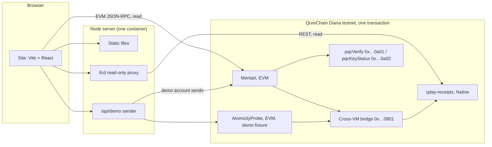

# Architecture

Mentari has four parts: two Solidity contracts on the EVM lane, one shared Native contract it writes to, a small Node
server, and a static site. This page explains how they fit and why. Each choice has a decision record in
[`decisions/`](decisions/), with how to undo it.

## The picture



## Contracts (`contracts/src/`)

`Mentari.sol` is the product. One unit is one watt-hour (`MTR`, 0 decimals).

| Function | What it does |
| --- | --- |
| `constructor(registrar, receiptsBook, maxSunHoursX10)` | Everything is fixed at deployment. There is no owner, pause, upgrade, `approve` or `payable` function. |
| `registerSystem(id, meter, producer, capacityW, firstDay, sig)` | The registrar's ML-DSA-87 signature over `"Mentari:register:v1"`, the chain id, the contract address, a nonce and the fields. Meter and producer must be quantum-ready. |
| `attest(id, day, wh, sig)` | Anyone may send it. The meter's ML-DSA-87 signature over `"Mentari:attest:v1"`, the chain id, the contract address and the fields. Mints `wh` to the producer once per system per past day, within the capacity limit. |
| `transfer(to, wh)` | Only to an account whose post-quantum key is registered with proof of possession. |
| `retire(wh, memo)` | Burns, builds the note, calls the bridge, reads the receipt id from the reply, checks that it is larger than the last one, and stores `Retirement{holder, wh, receiptId, timestamp}`. Guarded against re-entry. |

"Quantum-ready" means `pqcKeyStatus(account)` reports a registered ML-DSA-87 key with `possessionProven`.

`AtomicityProbe.sol` is a demo fixture, and the first comment in the file says so. It holds nothing. Each function makes a
bridge call that must fail, so the evidence can show the receipt count did not change:

- `recordThenRevert(note)` writes a receipt and then reverts.
- `nativeRefuses()` sends `{"fail":{}}`, which the receipts book always refuses.
- `callTarget(target, note)` calls a Native contract that is not on the governance allowlist.

The libraries in `contracts/src/lib/` keep each concern small: `CrossVm` (the bridge call), `ReceiptNote` (the note,
built from typed fields), `ReceiptReply` (reads the id from the reply and rejects anything malformed), and `Pqc` (the two
precompiles).

### The receipt note

```
MTR1 n=<retirement number> wh=<watt-hours> by=0x<40 lowercase hex> m=<memo>
```

The memo is 0 to 40 characters from `[A-Za-z0-9 .:/#-]`; every other field is a number or hex. None of those characters
can close the JSON string the note travels in, so the message `{"record":{"note":"…"}}` cannot be changed by a holder.
The longest possible note is 140 characters, the limit the workshop gives for the receipts book.

### Why the receiver check

An account that never registered a post-quantum key still answers to its classical key alone. Once a quantum computer can
break that key, whoever breaks it first can register their own post-quantum key for the account and take what it holds.
So certificates only move to accounts that have already done that step themselves. See
[`threat-model.md`](threat-model.md) for the source.

## Server (`server/src/`)

One Node 22 process, one container image:

- Serves the built site from `web/dist`. HTML is sent with `Cache-Control: no-cache, no-transform`; hashed assets are
  cached for a year.
- `GET /lcd/*` forwards to the public QoreChain REST API, but only for the path prefixes in
  [`config/limits.json`](../config/limits.json) (the receipts book queries, Cross-VM parameters, transactions, and the
  post-quantum key module). Other paths get 404, other methods 405, and the upstream host is fixed. Answers are cached for
  5 seconds. This exists because the REST API sends no CORS headers.
- `POST /api/demo/retire` and `/api/demo/case/<b|c|d>` send one transaction from the demo account and return the hash
  and the receipt counts before and after. Limits (one at a time, per IP per hour, per day, the off switch, the minimum
  balance) are in `config/limits.json`. When a limit is reached or the account is low, the page shows the recorded
  evidence and checks it again live.
- `POST /api/demo/grant/<address>` makes the demo account transfer `demo.grantWh` certificates to a visitor's wallet,
  under the same limits. It first checks `Mentari.isQuantumReady`, because `transfer` refuses accounts without a key.
- The client IP for rate limits is `cf-connecting-ip` only when the connection comes from a Cloudflare address
  (`config/cloudflare-ips.json`), so the header cannot be forged from outside.
- `GET /healthz` for the health watch.

The demo account's key is read from a read-only file mounted into the container at run time. It is never in the image or
the repository.

## Site (`web/`)

Vite, React and TypeScript, five pages: Registry, Retirements, Verify, Try it, How it works. EVM reads go straight to the
public JSON-RPC endpoint; Native reads go through `/lcd`. The "both ledgers agree" badge is computed in the browser: for
the latest retirements it reads `retirement(n)`, then `receipt{id}`, and checks the sender and the note. A failed read
says "could not check", never "disagree".

Until `contracts.mentari` is set in [`config/app.json`](../config/app.json), the site runs the same checks over
`web/fixtures/sample.json` and says on every page that the numbers are examples. All text is in `web/locales/en.json`
and `web/locales/ms.json`.

The Try it page also has a wallet path, loaded only on that page: QoreX through `@qorechain/qorex-rainbowkit` and
wagmi, the account's key status and balance, the grant above, and `retire` signed by the wallet. QoreX does not sign
EVM transactions yet, so today the last step is refused
([ADR 0010](decisions/0010-qorex-wallet-path.md)).

## Configuration

| File | Holds |
| --- | --- |
| [`config/app.json`](../config/app.json) | Network endpoints, chain ids, account roles, contract addresses, the receipts book, site settings |
| [`config/limits.json`](../config/limits.json) | Proxy allowlist and cache, trusted proxies, demo limits and amount, the self-test and its funds line, the deploy freeze |
| [`config/meter.json`](../config/meter.json) | The three simulated solar systems and the seeded sun-hour model |
| [`config/cloudflare-ips.json`](../config/cloudflare-ips.json) | Cloudflare address ranges for the client IP rule |

## Deployment

`deploy/deploy.sh` builds the image from the committed tree, starts it behind the host's reverse proxy at
`mentari.sasateguh.com`, checks `/healthz`, and keeps the previous image. `deploy/deploy.sh --rollback` goes back to it.
`deploy/uptime.sh` checks the public URL every 15 minutes. See [decision 0009](decisions/0009-container-deploy-and-health-watch.md).
`deploy/selftest.sh` runs every 6 hours while the entry is judged: honest demo status, the demo sender's funds and the
full public `verify`. From `config/limits.json` `deploy.freezeAfter` on, `deploy/deploy.sh` refuses a new deploy unless
the judges asked for a change. See [decision 0040](decisions/0040-self-test-and-deploy-freeze-while-judged.md).
