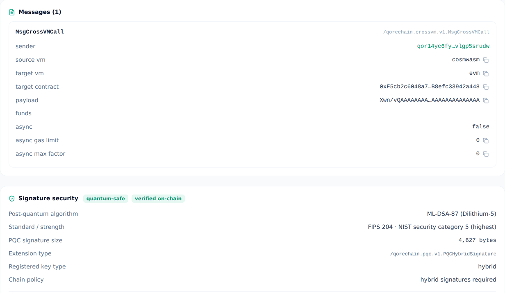

# Threat model

What Mentari protects, who might attack it, and what stops them. Each control points to the code and the test that
shows it. Where a reason comes from QoreChain's own documentation, the source is quoted.

## What is worth protecting

1. **One retirement, one receipt.** A certificate must not be retired twice, and a retirement must not exist on one
   ledger without the other.
2. **Who can mint.** Only a registered meter's reading may create watt-hours, once per day, within the capacity of
   its solar system.
3. **Who can hold.** Certificates must not sit on accounts that a future quantum attacker could take over.
4. **The demo account.** It holds test QOR and sends the "Retire now" transactions.

Out of scope: the real value of energy certificates (these have none), the solar hardware (the meter is simulated),
and the safety of the QoreChain chain itself.

## Threats and controls

| # | Threat | Control | Where it is tested |
| --- | --- | --- | --- |
| T1 | Someone with a leaked or broken classical key mints certificates | `registerSystem` needs the registrar's ML-DSA-87 signature and `attest` needs the meter's, both checked on chain with `pqcVerify`. The keys are read from `pqcKeyStatus` and must show `possessionProven`. | `contracts/test/mentari/` (wrong key, unregistered key, key without proof) |
| T2 | A valid signature is replayed | Signed messages include a version tag, `block.chainid` and the contract address; registration also includes a nonce; a second reading for the same system and day is refused. | replay tests: other chain, other contract, old nonce, same day |
| T3 | A meter reports more than its panels can make | `attest` refuses `wh` above `capacityW × maxSunHoursX10 / 10`, zero, today and the future. | unit tests and `testFuzz_*` on the limit |
| T4 | Certificates move to an account without a post-quantum key, which a quantum attacker could later claim | `transfer`, minting and registration require the receiver to be quantum-ready. Invariant 4: no balance on an address that is not. | `NotQuantumReady` tests, `invariant_*` |
| T5 | A holder changes the Native message through the memo (JSON injection) | The memo is 0 to 40 characters from `[A-Za-z0-9 .:/#-]`; the note is built from typed fields and is at most 140 characters. | `testFuzz_*` in `contracts/test/lib/`: no `"`, `\` or control character outside the fixed structure |
| T6 | The EVM side burns but the Native side does not record (or the other way) | The bridge call is in the same transaction. A refusal, an empty reply (bridge not active) or an unreadable reply reverts everything. The receipt id must be larger than the last one. | bridge mock modes; invariants 2 and 3; probe cases B, C, D |
| T7 | Re-entry during `retire` | `nonReentrant` guard; state is written before the event. | re-entry test (removing the guard turns it red) |
| T8 | An admin key is stolen | There is no admin: no owner, pause, upgrade, `approve` or `payable`. The registrar can only add systems, and only with an ML-DSA-87 signature. | constructor and interface tests |
| T9 | The demo button is used to drain the demo account | One request at a time, 5 per IP per hour, 40 per day, a minimum balance and an off switch, all in `config/limits.json`. The IP comes from `cf-connecting-ip` only when the peer is a Cloudflare address. | `server/test/` (limits, switch, low balance, forged headers) |
| T10 | The read proxy is used to reach other hosts or paths | Fixed upstream host; only the path prefixes in `config/limits.json`; GET only; dot segments, `//host` and `@host` refused. | `server/test/` (allowlist cases) |
| T11 | The demo account's key or a meter key leaks from the repository or image | The keys are mounted read-only at run time from outside the image; errors about the meter key file name the field, never the value; the repository and its history are scanned for secrets in CI. | secret scan in `scripts/gerbang-ujian.sh` |
| T12 | A leaked classical key spends a holder's certificates (`retire` and `transfer` are authorised by `msg.sender`) | The chain refuses EVM transactions from an account with no open EVM window, and only a post-quantum-signed `MsgOpenEVMWindow` opens one. Mentari's own jobs (Retire now, the failure buttons, `grant`, the daily meter) use the Native lane and open no window. | case I in `evidence/testnet.json`, checked by `pnpm verify` |

## What is signed, where, and who checks it

| Action | Post-quantum signature | Checked by | Lane |
| --- | --- | --- | --- |
| Register a solar system | Registrar's ML-DSA-87 signature over the system | `Mentari.registerSystem` with `pqcVerify` | EVM lane, scoped window, at setup |
| Daily meter reading | Meter's ML-DSA-87 signature over the reading | `Mentari.attest` with `pqcVerify` | Native lane, hybrid-signed, no window ([decision 0031](decisions/0031-daily-meter-attest-gas.md)) |
| Retire now | The demo account's hybrid signature (secp256k1 + ML-DSA-87) | The chain, before the call runs | Native lane, no window |
| Failure buttons (cases B, C, D) | The demo account's hybrid signature | The chain | Native lane, no window |
| `grant` (500 Wh to a visitor's wallet) | The demo account's hybrid signature | The chain | Native lane, no window. Not pressed on the testnet yet: it needs a visitor's wallet |
| Retire from your own wallet | None from the wallet: QoreX cannot sign this step yet | The chain's EVM window gate | EVM lane, only inside the holder's window |

Two kinds of check are in this table. The contract checks ML-DSA-87 signatures on readings and registrations itself.
For everything sent from the Native lane, the chain checks the hybrid signature before the EVM call runs; the contract
then sees an ordinary `msg.sender`.

On the testnet explorer (switch it to Testnet), the Native lane transactions show "Signature security: quantum-safe ·
verified on-chain", ML-DSA-87. This one is case I step 2, a `retire` from the buyer's account
(`97A5C80786442EC1C3866D0A890FE0E21915DB22B227F675A92F9873AE4CEA38`):

The early EVM lane transactions (cases A to D in `evidence/testnet.json`, the deploys and the first meter runs) show
"not quantum-safe": they were signed with secp256k1 inside a scoped window. Case B's EVM transaction
(`9837A24B…260CF8`) reverted inside the EVM, and the explorer still shows it as "success". The same case sent from the
Native lane (`4F9B5F8D…396703`) shows "failed (code 14)".

## Who may call `retire` and `transfer` (T12)

`retire` and `transfer` act on the certificates of `msg.sender`. They take no post-quantum signature of their own. The
contract's header comment says authority comes "from post-quantum signatures … not from `msg.sender`". That is true for
minting and registration. It is not true for these two functions, and the deployed contract will not change.

What stops a leaked classical key is the chain. Case I measured it on 24 November:

1. The buyer's account had no EVM window. I signed `Mentari.retire(500)` with its secp256k1 key alone. The same call
   succeeds as an `eth_call`. Sent as a transaction, the node refused it: "has no open EVM authorisation window; open
   one with MsgOpenEVMWindow, signed on the Cosmos lane with the account's post-quantum key". Nonce 6 before and after,
   certificates 1,000 before and after, retirements 21 before and after.
2. The same account sent the same `retire` from the Native lane, hybrid-signed: accepted at block 10658815
   (`97A5C80786442EC1C3866D0A890FE0E21915DB22B227F675A92F9873AE4CEA38`), retirements 21 to 22, receipts 30 to 31.

The limit: while an account has an open window, its classical key can call the window's targets until the window
ends. I did not test that case ([decision 0038](decisions/0038-classical-key-alone-cannot-spend.md)).

## Why the receiver must already have a post-quantum key (T4)

QoreChain accounts start with a classical (`ECDSA`) key. The first time an account registers its ML-DSA-87 key, the chain
accepts that transaction with the classical signature alone. The workshop guide says so directly:

> "This is the only transaction the chain accepts signed with the `ECDSA` key alone, because at this point the chain does
> not know your post-quantum key yet."
>
> Source: [`workshop-2/01-qday-vault/README.md`](https://github.com/qorechain/build-before-qday/blob/main/workshop-2/01-qday-vault/README.md),
> step 3, in qorechain/build-before-qday (Apache-2.0).

So an account that has not registered yet is protected only by its classical key. Whoever breaks that key first can
register their own post-quantum key and own the account. Sending certificates there would hand them to that person.
Mentari refuses, and asks the receiver to register first.

## Atomicity, in the workshop's words

> "The point is **atomicity**: both sides change together or neither does."
>
> Source: [`workshop-3/02-cross-vm/README.md`](https://github.com/qorechain/build-before-qday/blob/main/workshop-3/02-cross-vm/README.md).

Mentari relies on this property for T6 and shows it with the three probe cases. On the testnet, the evidence for each
case records the receipt count before and after.

## What the model does not cover

- **The receipts book is shared.** Anyone can write a receipt to `qday-receipts`. A Mentari receipt is one whose sender
  is the Mentari contract's own `qor1…` address and whose note matches a stored retirement. The site and the checks
  look at both.
- **Simulated meter.** The readings are generated, so T3 limits what a meter can claim, not whether the sun shone.
- **The EVM access window.** EVM transactions from an account are accepted only while its window is open. A leaked
  classical key could use an open window within its limits (T12). Mentari's own jobs no longer open one.
- **No professional audit.** The controls above are tested, fuzzed and checked by invariants, not audited.
